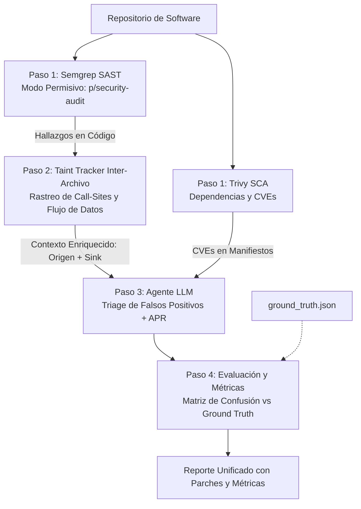

# 🛡️ SAST Antigravity - Plataforma Híbrida de Seguridad Asistida por IA (Semgrep + Trivy + Taint Tracker + LLM)

Plataforma de seguridad integral que combina escáneres estándar de la industria (**Semgrep** para SAST y **Trivy** para SCA), un **Taint Tracker** de flujo inter-archivo para resolución de *Call-Sites*, y modelos de lenguaje compactos (LLMs de 7B/8B parámetros) para auditar código fuente, dependencias de software y generar parches automáticos (**APR - Automated Program Repair**).

---

## 🎯 Arquitectura del Pipeline Híbrido



### Detalle de las Etapas:
1. **Paso 1 (Escaneo Estático Rápido):**
   - **Semgrep (SAST):** Escanea código en C, C++, Python, JavaScript, Go y Java utilizando reglas permisivas (`p/security-audit`) para maximizar la cobertura (*Recall*).
   - **Trivy (SCA):** Escanea manifiestos de paquetes (`requirements.txt`, `package.json`, etc.) buscando vulnerabilidades conocidas (CVEs).
2. **Paso 2 (Rastreo de Flujo Inter-Archivo - Taint Tracker):**
   - Supera la limitación de Semgrep Community (que solo mira dentro del mismo archivo).
   - Detecta la función contenedora del sumidero (*Sink*) y busca en todos los demás archivos del repositorio qué módulos la invocan (*Call-Sites*), construyendo la ruta completa `Origen -> Destino`.
3. **Paso 3 (Inferencia LLM & APR):** El Agente de IA analiza el contexto completo (invocador + sumidero):
   - Determina si la alerta es un **Falso Positivo** o una **Vulnerabilidad Real**.
   - Asigna clasificación taxonómica formal (**OWASP Top 10** y **MITRE CWE**).
   - Calcula puntaje y vector **CVSS v3.1**.
   - **Genera el código parchado y seguro (APR)** preservando la funcionalidad original.
4. **Paso 4 (Evaluación y Métricas):** Contrasta los veredictos contra las 40 debilidades del banco de pruebas ([`dataset_repos/ground_truth.json`](file:///c:/Users/Franco%20Sosa/Documents/SeguridadIA/dataset_repos/ground_truth.json)), calculando la Matriz de Confusión (TP, FP, FN, TN), Precision, Recall y F1-Score.

---

## 🏗️ Estructura del Repositorio

```text
SeguridadIA/
├── config.json                     # Configuración de URL del backend LLM (ngrok)
├── main.py                         # CLI unificado para escaneo, rastreo, auditoría y evaluación
├── sast/                           # Paquete central del motor SAST
│   ├── __init__.py                 # Exportación de la API pública
│   ├── semgrep_scanner.py          # Paso 1: Conector con Semgrep (SAST permisivo)
│   ├── taint_tracker.py            # Paso 2: Rastreador de flujos inter-archivo y Call-Sites
│   ├── trivy_scanner.py            # Paso 1: Conector con Trivy (SCA de dependencias)
│   ├── llm_client.py               # Paso 3: Cliente LLM, validación Pydantic y APR
│   └── evaluator.py                # Paso 4: Matriz de confusión frente a Ground Truth
├── dataset_repos/                  # Banco de pruebas (15 repositorios de código abierto)
│   ├── ground_truth.json           # Verdad de campo (40 debilidades controladas)
│   ├── metadata.json               # Metadatos descriptivos de los repositorios
│   ├── TESTBED_GUIDE.md            # Guía del banco de pruebas y taxonomía OWASP/CWE
│   └── [15 carpetas de repos]      # Python, JS, C, C++, Go, Java
└── COMANDOS.md                     # Manual detallado de comandos y ejemplos
```

---

## 🚀 Guía Rápida de Comandos (`main.py`)

*(Consulta [**COMANDOS.md**](file:///c:/Users/Franco%20Sosa/Documents/SeguridadIA/COMANDOS.md) para ver ejemplos detallados y opciones avanzadas).*

### 1. Comprobar Conexión con el Modelo
```bash
python main.py ping
```

### 2. Escanear Código Fuente con Semgrep (SAST)
```bash
# Escaneo permisivo de código
python main.py scan-code dataset_repos/python_colorama

# Escaneo con rastreo inter-archivo activado
python main.py scan-code dataset_repos/python_colorama --trace
```

### 3. Rastrear Flujos Inter-Archivo (Call-Sites hacia Sinks)
```bash
python main.py trace dataset_repos/python_pyjwt
```

### 4. Escanear Dependencias con Trivy (SCA)
```bash
python main.py scan-deps dataset_repos/python_flask_httpauth
```

### 5. Auditoría Completa Asistida por IA (Triage + Parches APR)
```bash
python main.py audit dataset_repos/python_colorama
```

### 6. Evaluación frente a Ground Truth (Matriz de Confusión)
```bash
python main.py evaluate --repo python_colorama
```