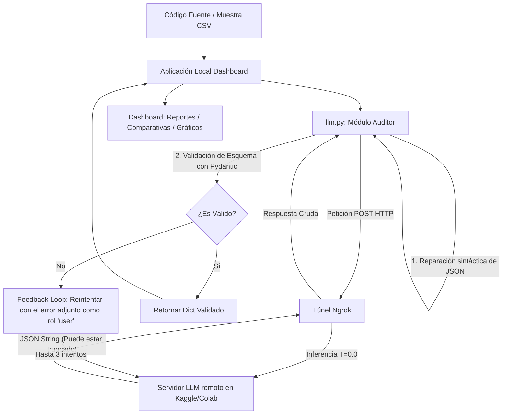

# LLM SAST & Automated Program Repair (APR) Dashboard

Investigación y desarrollo de un agente auditor basado en Modelos de Lenguaje compactos ($\le$ 14B / 32B) para **Análisis Estático de Seguridad de Software (SAST)**, estimación de gravedad de riesgo (**CVSS v3.1**) y **Reparación Automática de Vulnerabilidades (APR)**.

El sistema cuenta con un motor backend de auditoría iterativo con retroalimentación (feedback loop) y un **Dashboard Web interactivo** para la ejecución de pruebas, monitoreo en tiempo real de experimentos y análisis comparativo de métricas de rendimiento.

---

## 🎯 Objetivos del Proyecto

1. **Detección y Clasificación:** Identificar debilidades de código y clasificarlas según las categorías de **OWASP Top 10 (2021)** mapeadas a identificadores formales **MITRE CWE** (ej. `CWE-89` para Inyección SQL, `CWE-79` para XSS, `CWE-22` para Path Traversal).
2. **Estimación de Gravedad:** Determinar vectores de ataque de forma automática y calcular el puntaje base **CVSS v3.1** (0.0 a 10.0).
3. **Reparación de Código (APR):** Reescribir las funciones vulnerables de forma segura, garantizando la preservación de la lógica de negocio original y neutralizando la amenaza.
4. **Ejecución Robusta:** Integrar mecanismos de validación de datos sintácticos y semánticos (vía **Pydantic**) y ciclos de reintento con autocorrección para tolerar respuestas incompletas o malformadas del LLM.

---

## 📊 Datasets y Benchmarks de Evaluación

El proyecto utiliza datasets balanceados de alta calidad para el entrenamiento, validación y prueba de las capacidades del agente en **8 lenguajes de programación**: **Python, Java, JavaScript, C++, C, Go, PHP y Ruby**.

| Archivo | Ubicación | Casos | Balance (Seguro/Vulnerable) | Rol y Descripción | Fuentes de Origen |
| :--- | :--- | :--- | :--- | :--- | :--- |
| **`dev_balanced_benchmark2.csv`** | `datasets/` | **300** | 150 Seguros / 150 Vulnerables | **Desarrollo y Calibración:** Validación de prompts, calibración de hiperparámetros y optimización de reglas de detección. | [`CyberNative/Code_Vulnerability_Security_DPO`](https://huggingface.co/datasets/CyberNative/Code_Vulnerability_Security_DPO) y [`hitoshura25/cvefixes`](https://huggingface.co/datasets/hitoshura25/cvefixes) (para C) |
| **`test_balanced_benchmark.csv`** | `datasets/` | **300** | 150 Seguros / 150 Vulnerables | **Evaluación Final (Test Ciego):** Medición estadística objetiva de las métricas de rendimiento final sin solapamiento de código con el de desarrollo. | Proviene enteramente del dataset de correcciones reales [`hitoshura25/cvefixes`](https://huggingface.co/datasets/hitoshura25/cvefixes) |

### Estructura de Columnas de los Datasets:
*   `id`: Identificador único de la muestra.
*   `lenguaje`: Lenguaje de programación del código fuente.
*   `cwe_id`: Código CWE de la debilidad real (ej. `CWE-120` o `Seguro`).
*   `nombre_vulnerabilidad`: Nombre formal del fallo de seguridad (ej. `Buffer Overflow` o `Ninguna`).
*   `categoria_owasp`: Categoría oficial asignada dentro del OWASP Top 10 (ej. `A03:2021-Injection` o `Seguro`).
*   `codigo`: Bloque de código fuente (seguro o vulnerable) para analizar.
*   `es_vulnerable`: Indicador booleano (`True` / `False`) de la existencia real de una vulnerabilidad (Ground Truth).

---

## 🏗️ Arquitectura del Sistema



---

## 🛠️ Estructura del Repositorio

*   **`llm.py`**: Conector principal con el modelo de IA. Contiene las configuraciones del sistema, el **System Prompt** optimizado (con reglas de conservadurismo para mitigar falsos positivos), la clase de validación de Pydantic, algoritmos de extracción y reparación de JSON truncados, y el bucle de autocorrección.
*   **`evaluar_dev.py`**: Script de consola para ejecutar de forma autónoma el benchmark en lote sobre un archivo CSV y generar métricas estadísticas básicas.
*   **`config.json`**: Almacena la dirección del túnel de Ngrok actual (`NGROK_URL`) hacia el servidor del modelo.
*   **`Aplicacion/`**: Directorio de la plataforma web.
    *   `main.py`: Servidor backend desarrollado con **FastAPI** para controlar el flujo de experimentos en segundo plano, gestionar los resultados y servir archivos estáticos.
    *   `pruebas.json`: Archivo de persistencia de metadatos de los experimentos ejecutados.
    *   `static/`: Frontend construido con Vanilla HTML, CSS (diseño premium y responsivo en modo oscuro con glassmorphism) y Javascript interactivo.
    *   `resultados/`: Almacena las corridas detalladas de auditoría en formato CSV.
*   **`scripts/`**: Utilidades auxiliares del proyecto.
    *   `prepare_datasets.py`: Genera los datasets limpios y balanceados desde repositorios en la nube.
    *   `analyze_results.py`: Procesa archivos de resultados CSV y calcula matrices de confusión desglosadas por lenguaje.

---

## 🚀 Instrucciones de Configuración y Ejecución

### 1. Requisitos Previos
*   Python 3.12 o superior.
*   Entorno virtual configurado en la carpeta `.venv`.

### 2. Levantar el Servidor del LLM (Kaggle o Colab)
Asegúrate de ejecutar el cuaderno del modelo en Kaggle o Colab, levantar la API del chat (Uvicorn puerto 8000) y exponer el puerto a través de un túnel de Ngrok. 

Copia la dirección del túnel de Ngrok obtenida (ej. `https://XXXX-XXXX.ngrok-free.dev`) en tu archivo local `config.json`:
```json
{
  "NGROK_URL": "https://tu-subdominio-ngrok.ngrok-free.dev"
}
```

### 3. Levantar la Aplicación Web Local
Ejecuta el script de inicio en la raíz de tu proyecto:
```bash
./run.sh
```
El script activará el entorno virtual y levantará el backend del Dashboard en http://127.0.0.1:8000.

---

## 📊 Dashboard de Comparativa de Experimentos

La plataforma web incluye una potente sección de **Comparativa de Experimentos** que permite:
*   Seleccionar múltiples pruebas pasadas y visualizar una tabla cruzada interactiva con sus métricas clave desglosadas (FPR, FNR, Precisión de clasificación, etc.) junto con breves explicaciones pedagógicas de cada variable.
*   Comparar visualmente el rendimiento general de los modelos mediante gráficos dinámicos integrados.
*   **Resumen de Impacto Comparativo:** Cuando se seleccionan exactamente dos pruebas, el sistema genera automáticamente un análisis de rendimiento comparativo, destacando con indicadores de colores **verde** y **rojo** el incremento o reducción del rendimiento, las tasas de falsos positivos/negativos y las mejoras en los tiempos de inferencia.